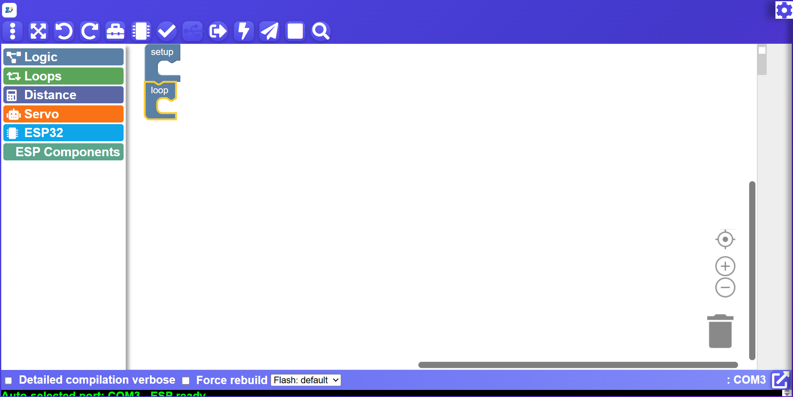
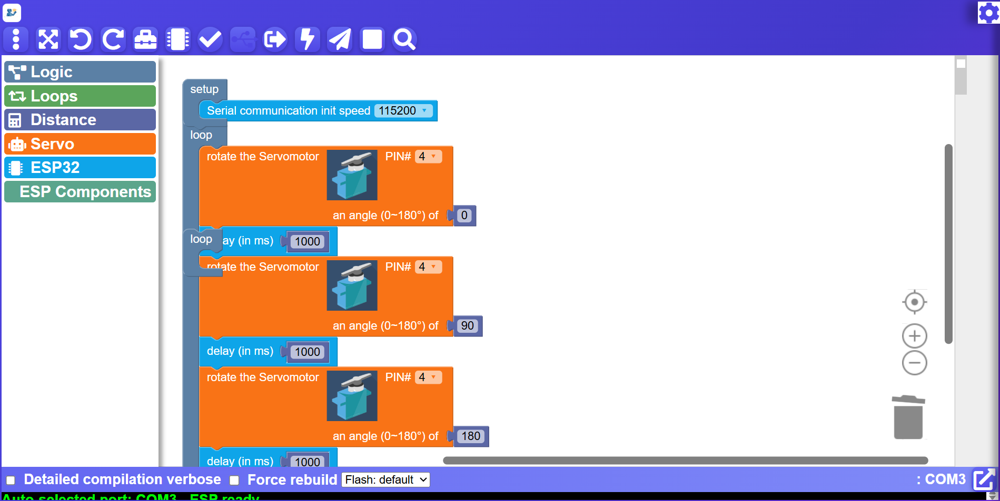
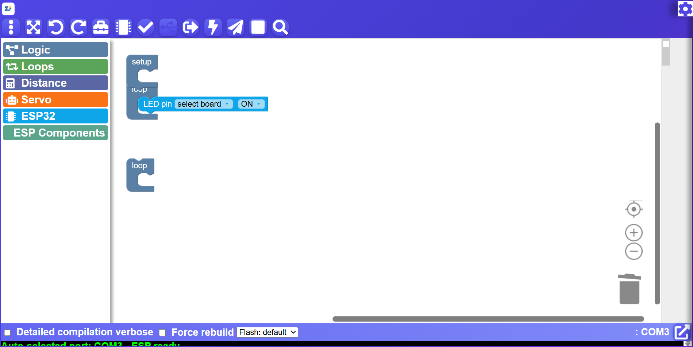
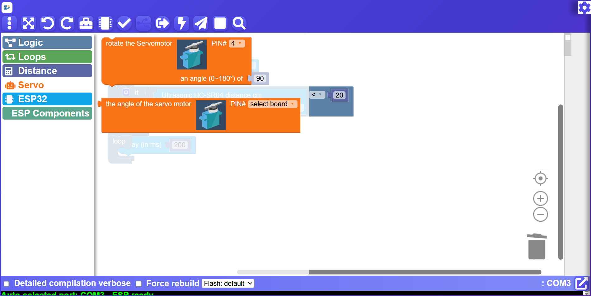

# Robosiddhi ESP IDE

Portable ESP32 / ESP8266 IDE — no install needed.

Double-click `Robosiddhi esp ide.exe` to run.

## ⬇️ EXE Download Link (v1.0.0)

> Note: ye repo **private** hai, isliye download link sirf wahi log use kar sakte hain jinke paas repo access hai (logged-in GitHub account + collaborator access chahiye).

**Direct download (GitHub Release):**

https://github.com/YOGESH11K/robosiddhi-esp-ide/releases/download/v1.0.0/Robosiddhi-ESP-IDE-v1.0.0.exe

Agar upar wali link se file name mismatch ho to Releases page se download karo:

https://github.com/YOGESH11K/robosiddhi-esp-ide/releases/tag/v1.0.0

## First time only (needs internet once)

1. Install USB driver for your board (CP210x or CH340/CH341).
2. In the app: board = ESP32 Dev Module (or your ESP board), port = COM port.
3. If compile asks for a missing core: settings (gear icon) -> CLI panel ->
   type `esp32:esp32` (or `esp8266:esp8266`) in install-board box -> download icon.
4. If a library is missing (.h error): same panel -> install-lib box.

## Screenshots

Current IDE (exe) and example block programs:



**Servo example**



**LED example**



**Ultrasonic example**



## Use

Load XML (menu -> Load) or drag blocks -> Upload -> green success ->
unplug/replug USB (or press RST) -> program runs.

Folder contents: exe + `compiler/` (arduino-cli + board files). Nothing else needed.
Cores and libraries live in Windows AppData after first install, then fully offline.

## Project structure (pura project isi repo me hai)

```
Robosiddhi esp ide.exe
compiler/
  arduino-cli.exe
  arduino-cli.yaml
  inventory.yaml
  library_index.json
  package_*.json
  packages/builtin/tools/...
README-Robosiddhi-ESP.txt
README.md
```

> Large `.exe` files Git LFS se tracked hain (`*.exe` in `.gitattributes`).
